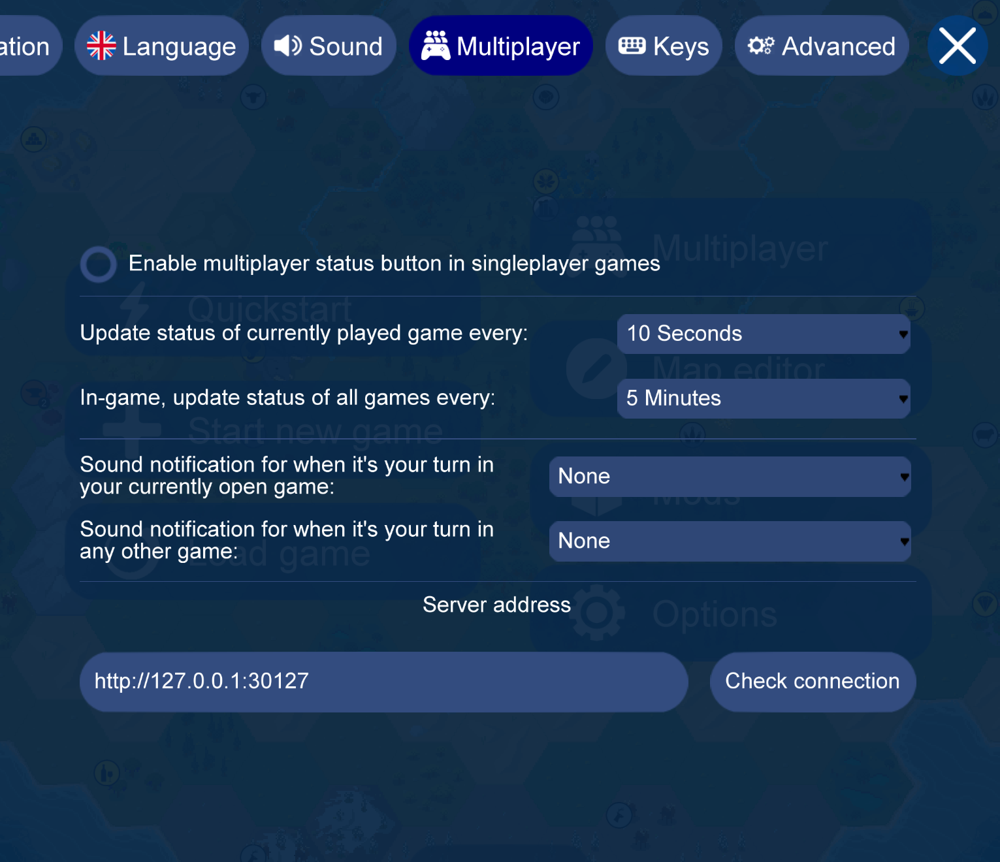
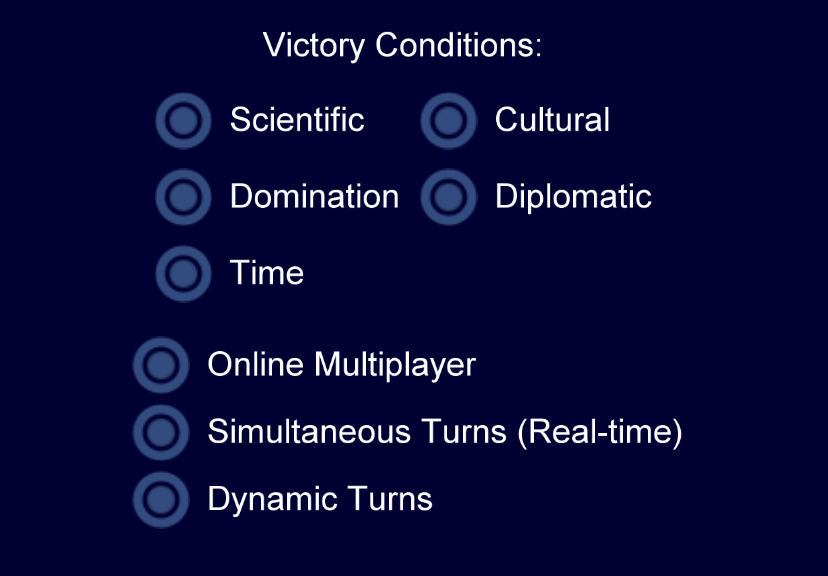
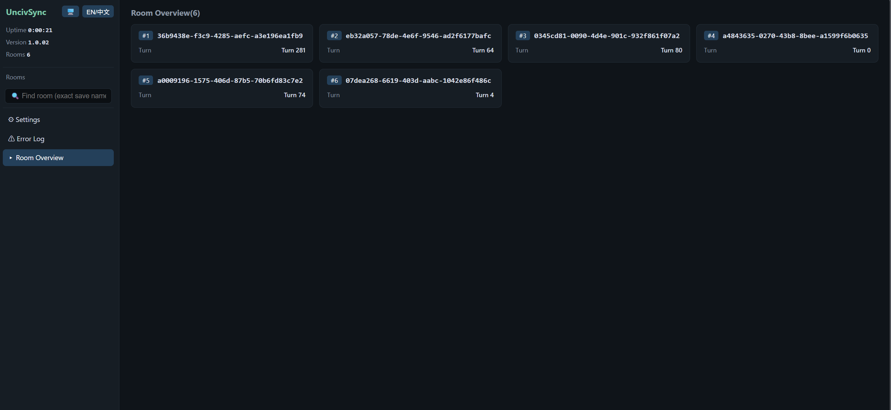
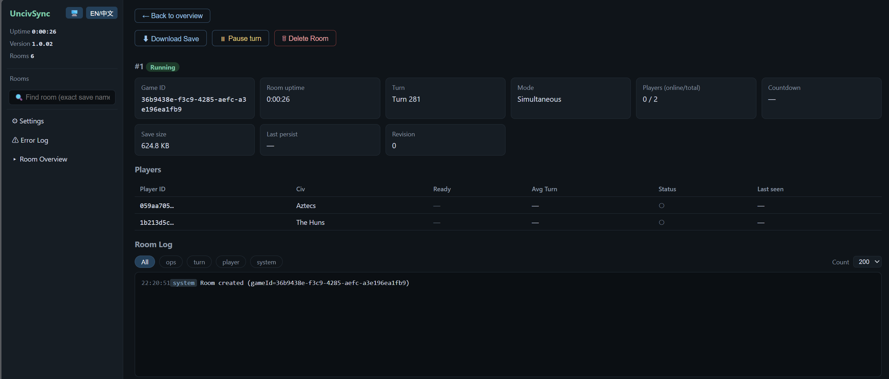

<p align="center"><a href="#简体中文">简体中文</a> · <a href="#english">English</a></p>

<h1 align="center">UncivSync</h1>

<p align="center"><strong>同步回合 / Simultaneous Turns</strong><br>基于 Unciv 的实时同步回合联机，支持自建服务器与网页房间管理<br>Simultaneous-turn multiplayer for Unciv, with self-hosted servers and browser-based room management.</p>

<p align="center">
  
  
  
  
</p>

## 简体中文

[English ↓](#english)

UncivSync 为 [Unciv](https://github.com/yairm210/Unciv) 加入了**实时同步回合联机**。多位玩家可以在同一个回合内移动单位、管理城市、研究科技和进行外交，减少等待其他人走完整个回合的时间。

只需一人开服，朋友们就能连接同一个服务端游玩。开服者可以在浏览器中查看房间、暂停对局和管理存档。

> 基于 Unciv **4.21.19**。请使用配套版本的客户端和服务端；不支持玩法模组。
> 注意：同步回合需要**自备服务端**，详细服务端搭建看下文

### 目录

- [项目特点](#项目特点)
- [同步回合](#同步回合)
- [下载与运行要求](#下载与运行要求)
- [启动服务端](#启动服务端)
- [连接与创建对局](#连接与创建对局)
- [网页房间管理](#网页房间管理)
- [服务端设置与备份](#服务端设置与备份)
- [从源码构建](#从源码构建)
- [常见问题](#常见问题)
- [许可与致谢](#许可与致谢)

### 项目特点

- **多人同时行动。**你安排城市生产时，朋友可以探索地图或调动军队，无须依次等待完整回合。
- **变化实时同步。**单位移动、战斗和城市变化会同步给其他玩家，不必手动刷新存档。
- **回合节奏可选。**等待全员就绪，或开启动态回合，让倒计时推动对局。
- **自己开服，网页管理。**服务端自带房间管理页，可以查看对局状态、暂停或恢复、下载存档。

| 对比项 | 常规异步联机 | UncivSync 同步模式 |
| --- | --- | --- |
| 玩家行动 | 玩家依次完成各自回合 | 多人在同一回合内行动 |
| 状态更新 | 围绕回合上传、下载存档 | 对局变化实时同步 |
| 回合推进 | 将行动权交给下一位玩家 | 全员就绪或倒计时结束后共同推进 |
| 房间管理 | 取决于所用存档服务 | 自带浏览器管理页面 |

### 同步回合

1. 所有玩家进入同一局游戏，在当前回合内各自行动。
2. 操作由服务端处理，结果同步到已连接的客户端。
3. 完成操作后点击 **Next Turn／结束回合**。全员就绪后，共同进入下一回合。
4. 开启 **Dynamic Turns／动态回合**后，倒计时结束也会推动回合。

操作会实时生效；对同一目标的操作会有先后顺序。

| 情况 | 游戏行为 |
| --- | --- |
| 开局首回合 | 不限时，便于准备 |
| 动态回合 | 后续回合启用倒计时，时长随回合推进逐步延长 |
| 全员提前就绪 | 可以提前进入下一回合 |
| 暂停与恢复 | 参局玩家可暂停或恢复，保留剩余倒计时 |
| 掉线 | 客户端尝试自动重连；超过 60 秒后，掉线玩家不再阻止其他人就绪推进 |
| 无真人在线 | 暂停回合推进，等待玩家返回 |

### 下载与运行要求

客户端与服务端请使用同一发布版本。

| 组件          | 文件                                                      | 运行要求                     |
| ----------- | ------------------------------------------------------- | ------------------------ |
| Windows 客户端 | `UncivSync.exe`                                         | 64 位 Windows，推荐 Java 21+ |
| Android 客户端 | `UncivSync.apk`                                         | 安装 APK，无需另装 Java         |
| 服务端         | `server.jar`、`UncivSync.jar`、`kotlin-stdlib-2.4.10.jar` | Java 21+，三个 JAR 放在同一目录   |
| 网页管理页       | 随服务端提供                                                  | 浏览器                      |

Windows 客户端和服务端不内置 Java。游玩或开服需**安装 Java 运行环境**，从源码构建需要 JDK。

### 启动服务端
#### 1. 准备文件并启动

将三个服务端 JAR 放在同一文件夹：
```text
Windows-Server/
├── server.jar
├── UncivSync.jar
└── kotlin-stdlib-2.4.10.jar
```
在这个文件夹打开终端，执行：

```sh
java -version
java -jar server.jar --admin-pass "YOUR_ADMIN_PASSWORD"
```

将 `YOUR_ADMIN_PASSWORD` 换成自己的管理口令。首次启动会自动建立存档目录和所需缓存。

#### 2. 连接地址

| 用途 | 默认地址 | 端口 |
| --- | --- | --- |
| 客户端连接 | `http://服务器IP:30127` | TCP `30127`，向参局玩家开放 |
| 网页管理 | `http://服务器IP:30217/admin` | TCP `30217`，仅向管理员开放 |

### 连接与创建对局

#### 每位玩家配置连接

1. 运行客户端
2. 打开 **Options → Multiplayer／设置 → 多人游戏**。
3. 在 **Server address／服务器地址**填写 `http://服务器IP:30127`，保留 `http://`。
4. 点击 **Check connection／检测连接**，按提示完成密码设置或输入。



#### 房主创建对局

1. 每位玩家进入**多人游戏 → 复制玩家 ID（Copy your user ID）**，把 ID 发给房主。
2. 房主新建游戏，勾选 **Online Multiplayer／在线多人游戏**和 **Simultaneous Turns (Real-time)／实时同步回合**。
3. 安排至少两名真人玩家，为每个真人文明填写对应玩家 ID；也可以加入 AI 文明。
4. 选择 **Civ V - Vanilla**，按需开启 **Dynamic Turns／动态回合**。
5. 开始游戏并分享**游戏 ID**，也可从多人游戏列表复制。
6. 其他玩家进入**多人游戏 → 添加多人游戏**，填写游戏 ID 后加入。

每人使用不同的**玩家 ID**，所有人加入相同的**游戏 ID**。换设备时请保留自己的玩家 ID，以及为该服务端设置的密码。



*图示为选项位置；创建游戏时勾选所需选项。*

### 网页房间管理

管理页随服务端启动，无须另外安装网站程序。浏览器打开：

```text
http://服务器IP:30217/admin/?pw=你的管理口令
```

口令包含特殊字符时需要 URL 编码。地址中包含管理口令，请妥善保管。

#### 房间总览

总览页列出房间卡片，可点击进入详情，或使用完整游戏 ID 查找。侧栏显示服务端版本、运行时间和房间数量。



#### 房间详情

- 查看回合、倒计时、暂停状态、玩家文明、在线和就绪情况。
- 查看事件日志，并按类别筛选。
- 暂停或恢复房间，下载存档，删除不再需要的房间。
- 查看服务端错误日志。



### 服务端设置与备份

查看全部启动参数：

```sh
java -jar server.jar --help
```

| 参数 | 默认值 | 用途 |
| --- | --- | --- |
| `--port N` | `30127` | 游戏连接端口 |
| `--admin-port N` | `30217` | 管理页端口；`0` 表示与游戏端口共用 |
| `--admin-pass PASSWORD` | 未设置 | 管理页访问口令 |
| `--saves DIR` | 服务端旁的 `Saves/` | 存档目录 |

### 从源码构建

<details>
<summary>展开构建步骤</summary>

Windows 构建需要 **JDK 21+、Python 3.9+ 和 Launch4j**；安卓构建还需要 Android SDK。配置 `JAVA_HOME`，并让 `launch4jc` 可从 `PATH` 或 `LAUNCH4JC` 找到。

在仓库根目录打开 PowerShell：

```powershell
Set-Location .\client
.\gradlew.bat :desktop:dist

Set-Location ..\server
python deploy-client.py
python build.py
```

客户端和服务端生成在 `server/build/deploy/`。运行其中的 `Server/server.jar` 时，保持两个依赖 JAR 同级。

安卓构建：设置 `ANDROID_HOME`，在 `client/` 中执行：

```powershell
.\gradlew.bat :android:assembleRelease
```

APK 位于 `client/android/build/outputs/apk/release/`。正式分发更新时请使用自己的稳定签名。

</details>

### 常见问题

| 问题 | 检查方法 |
| --- | --- |
| 连接检测失败 | 确认服务端运行、地址带 `http://`、端口为 `30127`，并检查防火墙 |
| 本机能连，其他设备不能连 | 其他设备应填写服务端可访问地址，不能使用自己的 `127.0.0.1` |
| 管理页无法访问 | 默认使用 `30217`；共用端口时使用游戏端口，并保留 `/admin/?pw=...` |
| 管理页提示未授权 | 检查管理口令和 URL 编码；本机访问也需口令 |
| 提示缺少类或 passive mode | 保持三个配套 JAR 同级，检查启动日志中的规则集加载结果 |
| 无法控制自己的文明 | 检查房主分配的玩家 ID，避免多人共用同一 ID |
| 回合没有推进 | 检查就绪、暂停、掉线等待和动态回合设置；首回合不限时 |

当前版本面向可信玩家之间的联机，支持 **Civ V - Vanilla**，不支持玩法模组。服务端使用 HTTP／WebSocket，玩家密码明文保存；请使用独立密码并限制网络访问。管理口令不保护所有游戏接口。

欢迎反馈问题和改进建议。报告问题时请附版本、系统和复现步骤，并先清除日志或存档中的个人信息。

### 许可与致谢

本项目新增与修改部分、原创服务端作者：**W1ndHang**。

联系邮箱：[w1ndhang@163.com](mailto:w1ndhang@163.com)

| 部分 | 许可 |
| --- | --- |
| 基于 Unciv 的客户端源码及修改 | [Mozilla Public License 2.0](client/LICENSE) |
| 本项目原创服务端源码及构建脚本 | [PolyForm Noncommercial 1.0.0](server/LICENSE) |

服务端许可限定非商业用途，允许在条款范围内使用、修改和分发，并要求保留许可与必要署名。客户端和第三方资源保留各自许可；完整范围见 [LICENSE](LICENSE)。

感谢 [Unciv](https://github.com/yairm210/Unciv)、[libGDX](https://github.com/libgdx/libgdx) 及开发者、翻译者、艺术家和社区贡献者。资源署名与授权来源见 [CREDITS.md](CREDITS.md)。

---

## English

[简体中文 ↑](#简体中文)

UncivSync adds **simultaneous-turn multiplayer** to [Unciv](https://github.com/yairm210/Unciv). Players can move units, manage cities, research technologies, and conduct diplomacy during the same turn, reducing the wait for everyone else to finish a full turn.

One person hosts the server, and friends connect to play. The host can inspect rooms, pause games, and manage saves from a browser.

> Based on Unciv **4.21.19**. Use matching client and server releases; gameplay mods are not supported.
> Note: simultaneous turns require a **self-hosted server**. See the server setup instructions below.

### Contents

- [Features](#features)
- [Simultaneous turns](#simultaneous-turns)
- [Download and requirements](#download-and-requirements)
- [Start a server](#start-a-server)
- [Connect and create a game](#connect-and-create-a-game)
- [Web room management](#web-room-management)
- [Server settings and backups](#server-settings-and-backups)
- [Build from source](#build-from-source)
- [Troubleshooting](#troubleshooting)
- [Licensing and credits](#licensing-and-credits)

### Features

- **Act together.** Manage city production while your friends explore or move armies, without waiting through their entire turns.
- **See changes live.** Unit movement, combat, and city changes are synchronized without manually refreshing saves.
- **Choose the pace.** Wait for everyone to be ready, or enable Dynamic Turns to advance with a countdown.
- **Host and manage your own games.** The server includes a browser dashboard for inspecting rooms, pausing or resuming, and downloading saves.

| Aspect | Conventional asynchronous multiplayer | UncivSync simultaneous mode |
| --- | --- | --- |
| Player actions | Players complete their turns in sequence | Players act during a shared turn |
| Updates | Saves are uploaded/downloaded around turns | Game changes are synchronized live |
| Turn progression | Control passes to the next player | Everyone advances when ready or when the timer expires |
| Room management | Depends on the save service | Browser dashboard included |

### Simultaneous turns

1. Players join the same game and act during the current turn.
2. The server processes actions and synchronizes the results to connected clients.
3. Select **Next Turn** when finished. The game advances when everyone is ready.
4. With **Dynamic Turns** enabled, the countdown can also advance the turn.

Actions take effect live; actions competing for the same target have an execution order.

| Situation | Behavior |
| --- | --- |
| Opening turn | Untimed, allowing time to prepare |
| Dynamic Turns | Later turns use a countdown that gradually grows with the turn number |
| Everyone ready early | The game can advance before the countdown expires |
| Pause and resume | Participating players can pause/resume while preserving the remaining time |
| Disconnection | Clients try to reconnect; after 60 seconds, a disconnected player no longer blocks readiness |
| No human players online | Turn progression pauses until players return |

### Download and requirements

Use the same release version for clients and the server.

| Component | Files | Requirements |
| --- | --- | --- |
| Windows client | `UncivSync.exe` | 64-bit Windows; Java 21+ recommended |
| Android client | `UncivSync.apk` | Install the APK; no separate Java installation |
| Server | `server.jar`, `UncivSync.jar`, `kotlin-stdlib-2.4.10.jar` | Java 21+; keep all three JARs together |
| Browser dashboard | Included with the server | Browser |

The Windows client and server do not bundle Java. **Install a Java runtime** to play on Windows or host a server; building from source requires a JDK.

### Start a server

#### 1. Prepare the files and launch

Keep all three server JARs in one folder:

```text
Windows-Server/
├── server.jar
├── UncivSync.jar
└── kotlin-stdlib-2.4.10.jar
```

Open a terminal in that folder and run:

```sh
java -version
java -jar server.jar --admin-pass "YOUR_ADMIN_PASSWORD"
```

Replace `YOUR_ADMIN_PASSWORD` with your own management password. Save and cache directories are created on the first run.

#### 2. Connection addresses

| Purpose | Default address | Port access |
| --- | --- | --- |
| Client connection | `http://SERVER_IP:30127` | TCP `30127`, available to participating players |
| Browser dashboard | `http://SERVER_IP:30217/admin` | TCP `30217`, restricted to administrators |

### Connect and create a game

#### Configure each client

1. Launch the client.
2. Open **Options → Multiplayer**.
3. Enter `http://SERVER_IP:30127` in **Server address**, including `http://`.
4. Select **Check connection** and follow any password prompt.


#### Create the game

1. Each player selects **Multiplayer → Copy your user ID** and shares that ID with the host.
2. The host creates a new game and enables **Online Multiplayer** and **Simultaneous Turns (Real-time)**.
3. Add at least two human players and assign each human civilization its player's ID. AI civilizations are optional.
4. Select **Civ V - Vanilla** and optionally enable **Dynamic Turns**.
5. Start the game and share its **game ID**, also available from the multiplayer list.
6. Other players select **Multiplayer → Add multiplayer game**, enter the game ID, and join.

Each person needs a different **player ID**, while everyone joins the same **game ID**. Preserve your player ID and server password when moving devices.


*The screenshot shows option locations; enable the settings you need when creating a game.*

### Web room management

The dashboard starts with the server, without a separate website installation. Open:

```text
http://SERVER_IP:30217/admin/?pw=YOUR_ADMIN_PASSWORD
```

URL-encode special password characters. The address contains the management password, so keep the link private.

#### Room overview

Open a room card for details, or search by its full game ID. The sidebar shows the server version, uptime, and room count.


#### Room details

- View the turn, countdown, pause state, civilizations, online status, and readiness.
- Read and filter the event log.
- Pause or resume rooms, download saves, and delete rooms you no longer need.
- Inspect server errors.


### Server settings and backups

List all startup options:

```sh
java -jar server.jar --help
```

| Option | Default | Purpose |
| --- | --- | --- |
| `--port N` | `30127` | Game connection port |
| `--admin-port N` | `30217` | Dashboard port; `0` shares the game port |
| `--admin-pass PASSWORD` | Unset | Dashboard password |
| `--saves DIR` | `Saves/` beside the server | Save directory |

### Build from source

<details>
<summary>Show build steps</summary>

Windows builds require **JDK 21+, Python 3.9+, and Launch4j**. Android additionally requires its SDK. Set `JAVA_HOME` and make `launch4jc` available through `PATH` or `LAUNCH4JC`.

From the repository root in PowerShell:

```powershell
Set-Location .\client
.\gradlew.bat :desktop:dist

Set-Location ..\server
python deploy-client.py
python build.py
```

The client and server are generated under `server/build/deploy/`. Keep both dependency JARs beside `Server/server.jar` when running it.

For Android, set `ANDROID_HOME` and run from `client/`:

```powershell
.\gradlew.bat :android:assembleRelease
```

The APK is generated under `client/android/build/outputs/apk/release/`. Use your own stable signing key for public updates.

</details>

### Troubleshooting

| Problem | Check |
| --- | --- |
| Connection check fails | Server running, full `http://` address, port `30127`, and firewall access |
| Works locally but not from another device | Use the server's reachable address; another device's `127.0.0.1` points to itself |
| Dashboard unavailable | Use `30217` by default, or the game port when shared; keep `/admin/?pw=...` |
| Dashboard reports unauthorized | Check the password and URL encoding; local access also needs the password |
| Missing classes or passive mode | Keep the three matching JARs together and inspect ruleset initialization in startup logs |
| Cannot control a civilization | Check assigned player IDs; avoid sharing one identity |
| Turn does not advance | Check readiness, pause, disconnected players, and Dynamic Turns; the opening turn is untimed |

This version is intended for trusted-player games using **Civ V - Vanilla**, without gameplay mods. The server uses HTTP/WebSocket and stores player passwords as plain text. Use a separate password and restrict network access. The dashboard password does not protect every game interface.

Bug reports and suggestions are welcome. Include the version, operating system, and reproduction steps, and remove personal information from logs or saves before sharing them.

### Licensing and credits

UncivSync-specific additions and modifications, including the original server, are by **W1ndHang**.

Contact: [w1ndhang@163.com](mailto:w1ndhang@163.com)

| Component | License |
| --- | --- |
| Unciv-based client source and modifications | [Mozilla Public License 2.0](client/LICENSE) |
| Original UncivSync server source and build helpers | [PolyForm Noncommercial 1.0.0](server/LICENSE) |

The server license permits use, modification, and distribution for permitted noncommercial purposes, with the license and required notices retained. The client and third-party materials keep their respective licenses. See [LICENSE](LICENSE) for the scope.

Thanks to [Unciv](https://github.com/yairm210/Unciv), [libGDX](https://github.com/libgdx/libgdx), and their developers, translators, artists, and community contributors. Asset credits and license sources are listed in [CREDITS.md](CREDITS.md).
